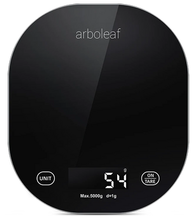
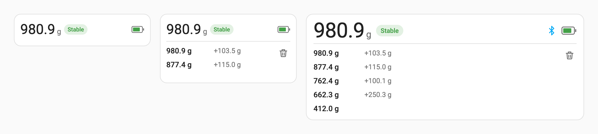
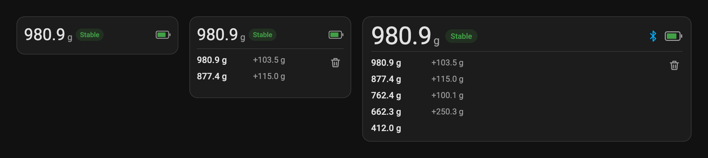

# QN Kitchen Scale for Home Assistant

[](https://github.com/jaxer/ha-qn-kitchen-scale/actions/workflows/ci.yml)
[](https://hacs.xyz)

<a href="https://www.arboleaf.com/products/food-scale-ck10a"></a>

Local Bluetooth integration for **QN-KS** kitchen scales: the ones sold as **Yolanda CK10A**,
**Arboleaf CK10A** and under other names, with the "Yolanda" / "Arboleaf" phone app.
No cloud, no app: Home Assistant connects to the scale through any Bluetooth adapter or
ESPHome Bluetooth proxy and reads the weight stream directly.

<br clear="right">

## What you get

| Entity | Meaning |
|---|---|
| `sensor.qn_ks_weight` | What the display shows right now, including negative values after tare: 0.1 g steps below 1 kg, 1 g steps above, about 5 updates per second while the weight changes. Unavailable while the scale sleeps. Attributes `stable`, `tare` (tare set on the scale) and `display_unit` (what the display shows: g, ml, ml_milk, oz, lb_oz; the sensor is always in grams). |
| `sensor.qn_ks_last_measurement` | The newest **measurement**: a reading that settled for a moment. Attributes: `measured_at`, `delta_g` (change since the previous measurement in the same session), `session`, and `measurements`, the newest-first history of the last 50. |
| `sensor.qn_ks_battery` | Battery level, read when the scale connects. |
| `binary_sensor.qn_ks_connected` | On while Home Assistant holds the connection. |

A *measurement* is recorded when a non-zero reading stays stable for three frames and differs from
the previous measurement by more than 1 % of it (at least 1 g). Put a bowl on the scale, add flour, add sugar: that is
three measurements, each with its delta, so the history reads like a recipe. Lifting everything off
resets the deltas; switching the scale off and on starts a new session.

The history survives restarts. The `qn_kitchen_scale.clear_measurements` action empties it.

## Requirements

* Home Assistant 2026.4 or newer with the [Bluetooth](https://www.home-assistant.io/integrations/bluetooth/)
  integration: a local adapter or an [ESPHome Bluetooth proxy](https://esphome.io/components/bluetooth_proxy)
  with `active: true` within range of the scale.
* The scale cannot be connected to the phone app and Home Assistant at the same time.

## Installation

### HACS

1. HACS → Integrations → ⋮ → *Custom repositories*, add `https://github.com/jaxer/ha-qn-kitchen-scale`
   as an *Integration*.
2. Install **QN Kitchen Scale** and restart Home Assistant.

### Manual

Copy `custom_components/qn_kitchen_scale` into your `config/custom_components` folder and restart.

## Setup

Switch the scale on. Home Assistant discovers it (`QN-KS`) and offers to add it under
Settings → Devices & services. You can also add it by hand from the same page while the scale is awake:
search for "QN", "Yolanda" or "Arboleaf".

## Dashboard card

The integration ships its own card and loads it on every dashboard: no resource to add. Pick
**QN Kitchen Scale** in the card picker, or:

```yaml
type: custom:qn-kitchen-scale-card
entity: sensor.qn_ks_weight   # optional: the first scale is used without it
```




It shows the live weight with a *Stable* tag once the reading settles, a *Tare* tag and the display
unit when they are set on the scale, Bluetooth and battery icons, and the latest measurements
(absolute weight, the change in grey) with a button that clears them after a confirmation. Each
scale session (switching the scale on) opens with the time it started, *Today, 14:32* or *20 Oct, 08:40*,
so the measurements you just made stand apart from older ones; a card with fewer than three rows
shows the plain list. In a
sections dashboard the card adapts to its size: at 3 × 1 it shows only the weight, and the list
shows as many measurements as the height fits. Elsewhere it shows `max_items` measurements
(default 5).

### Markdown alternative

A Markdown card renders the `measurements` attribute as a table, newest first:

```yaml
type: markdown
title: Весы
content: >-
  
  | Время | Вес | Δ |
  |---|---:|---:|
  
  | {{ as_timestamp(m.at) | timestamp_custom('%H:%M:%S') }} | {{ m.weight_g }} g | {{ '' if m.delta_g is none else ('%+.1f g' % m.delta_g) }} |
  
```

## Protocol

Documented in [docs/protocol.md](docs/protocol.md). The parser lives in
[`protocol.py`](custom_components/qn_kitchen_scale/protocol.py) and the measurement detector in
[`session.py`](custom_components/qn_kitchen_scale/session.py); both are pure Python with tests
against frames captured from a real scale.

## Development

```bash
python3.14 -m venv .venv && . .venv/bin/activate
pip install -r requirements_test.txt
ruff check . && ruff format --check . && pytest
```

## License

MIT
